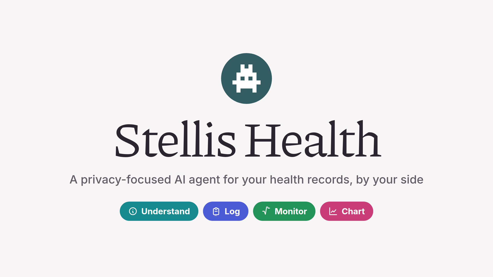
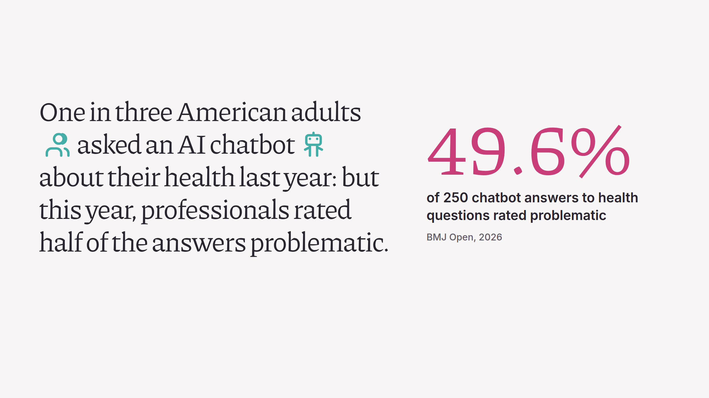
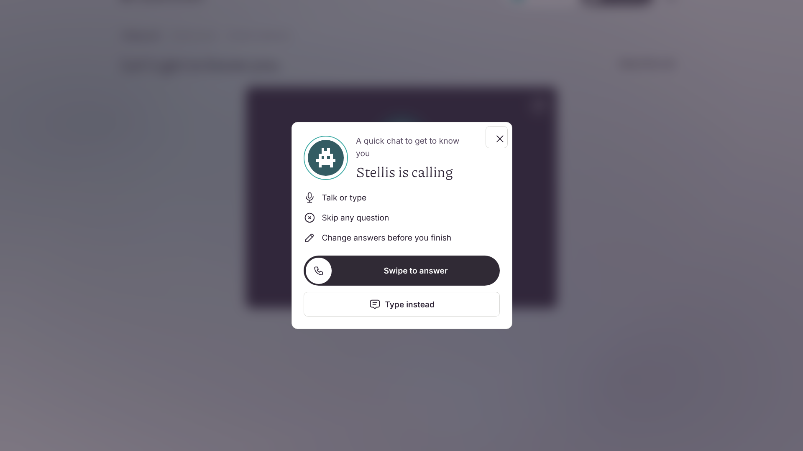
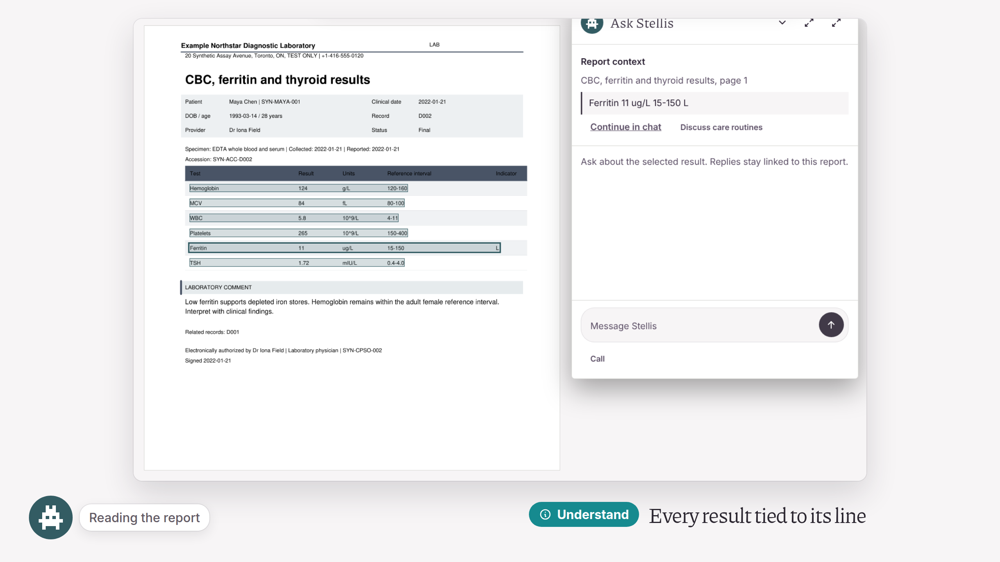
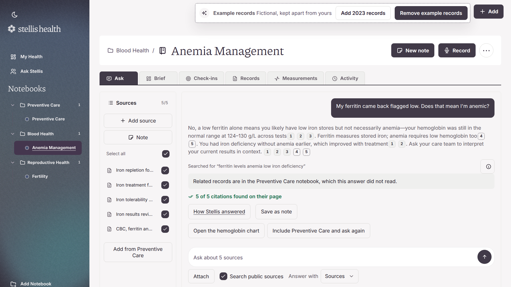
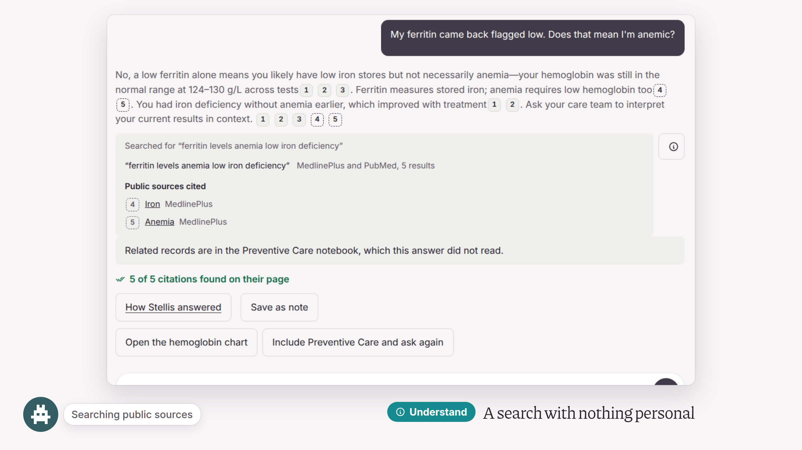
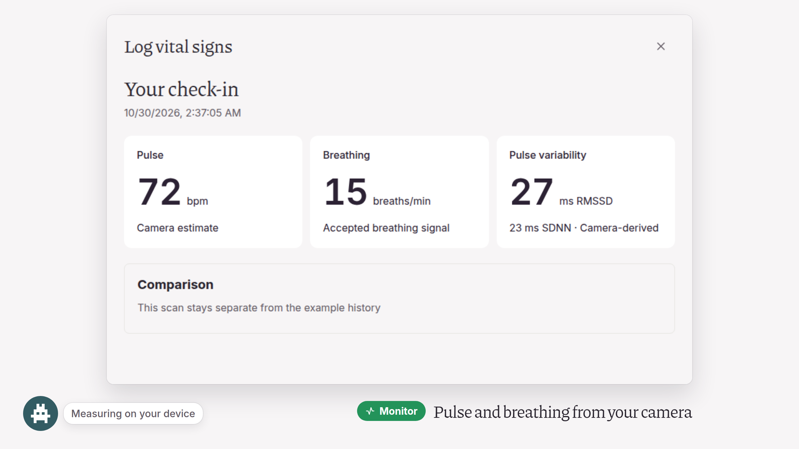
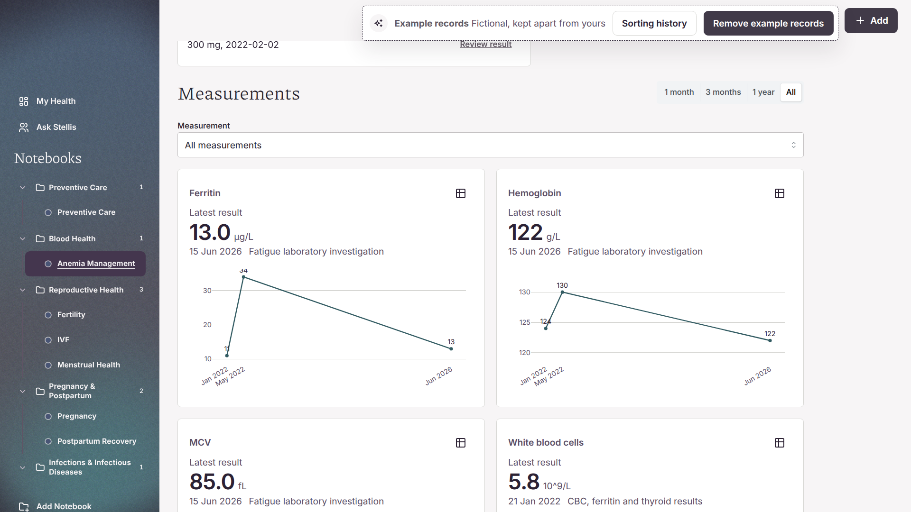
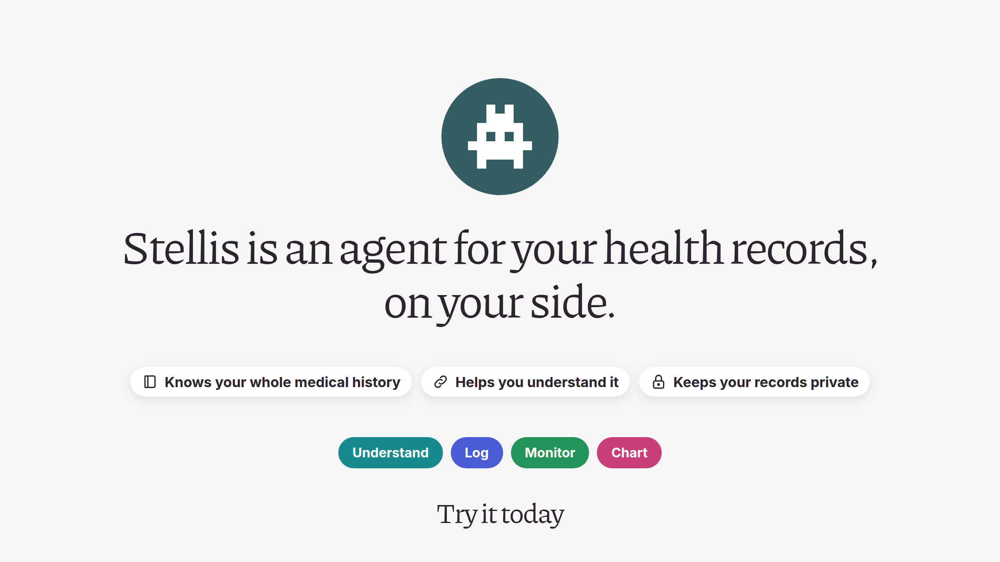

<p align="center"></p>

# Stellis Health

Stellis is an open-source, privacy-first AI agent for your health records. Add your lab reports, letters and visit recordings, and Stellis helps you understand, log, monitor and chart your health over time.

Try it at <https://204-12-180-88.sslip.io>. **Try the demo** there walks through a fictional patient's five years of records, in a short or a full tour.

<p align="center"></p>

## Why

About one in three American adults asked an AI chatbot about their health last year (Pew Research Center). In a 2026 BMJ Open study, professionals rated half of 250 chatbot answers to health questions problematic. To give better advice, an assistant needs your real history over time, research it checks, and tools that help you make sense of what you're told.

## What it does

**Understand**
- **Reads your reports.** Upload a lab report, letter or photo and it opens with Stellis's summary beside it. Stellis finds the date and each result, ties each result to its row on the page, and adds them to your history when you approve.
- **Answers from your records.** Ask anything, such as how a result has changed. Each answer links to the page it came from, and Stellis checks every citation against its source.
- **Researches without sharing your records.** When a question needs outside research, Stellis searches Tavily, MedlinePlus and PubMed with a query that has nothing personal in it. Public sources are cited apart from your records.

**Log**
- **Summarizes your visits.** Record an appointment or upload a recording. Stellis transcribes it and writes up what was decided.
- **Keeps track of medicines and goals.** Tick off doses and goals. When a clinician changes a medicine, Stellis quotes their words and adds the change only after you approve it. Stellis never stops a medicine itself: a fixed rule, not the model, sends you back to your prescriber.

**Monitor**
- **Checks your vital signs.** Pulse, breathing, heart rate variability and a blood pressure estimate from about 30 seconds of webcam video. The video is processed in the browser and stays on your device.

**Chart**
- **Charts your results.** Lab results and home readings appear together on one timeline, each point linked to its record.

## Gallery

| | | |
| --- | --- | --- |
| [](docs/gallery/01-the-problem.png) | [](docs/gallery/03-stellis-calls-to-set-up.png) | [](docs/gallery/04-every-result-tied-to-its-line.png) |
| The problem | Setup starts with a short call | Every result tied to its line |
| [](docs/gallery/05-answers-cite-their-sources.png) | [](docs/gallery/06-a-search-with-nothing-personal.png) | [](docs/gallery/07-camera-vitals.png) |
| Answers cite their sources | A search with nothing personal | Vital signs from your camera |
| [](docs/gallery/08-every-result-over-the-years.png) | [](docs/gallery/09-on-your-side.png) | |
| Every result over the years | On your side | |

## Where your data goes

| Part | Where | What it does |
| --- | --- | --- |
| Browser | Your device | The app. Camera video for vital signs never leaves it |
| Stellis server | One Nebius AI Cloud virtual machine, United States | Stores each account's records encrypted (AES-256-GCM) with a key only that person's password or recovery key unlocks. Reads scanned pages and transcribes recordings itself. Removes names and ID numbers before anything goes to a model |
| Nebius Token Factory | Nebius | Runs the language models, with zero data retention |
| Web research | MedlinePlus, PubMed, Tavily | Receives only the topic of a question, never personal details |

[How Stellis works](docs/architecture.md) has the diagram, and what each part does for you.

## Models

Stellis uses NVIDIA Nemotron models as they are, with no fine-tuning, served by Nebius Token Factory. Each task has its own instructions, and code checks the output before you see it.

| Task | Model |
| --- | --- |
| Answers, research, reading reports, care review | Nemotron Super 120B |
| Naming documents and quick text tasks | Nemotron 3.5 Lightning |

## Run it

You need Python 3.12, [uv](https://docs.astral.sh/uv/getting-started/installation/), Node.js 22 for the tests, and Tesseract with English data (`tesseract-ocr` and `tesseract-ocr-eng` on Debian or Ubuntu).

1. Download the demo's records. They are the [stellis-health-demo dataset](https://huggingface.co/datasets/reversely/stellis-health-demo), not part of this repository; without them the demo is off.

   ```sh
   python3 scripts/fetch_demo.py
   ```

2. Start the app and open <http://127.0.0.1:8765>. The first start downloads the speech models.

   ```sh
   STELLIS_RUNTIME_PROFILE=direct uv run --locked stellis serve
   ```

3. For summaries, answers and agents, set `NEBIUS_API_KEY` to a Nebius Token Factory key. Recording, transcription and reading scanned pages work without one.

## Test it

The tests use the demo's records, so fetch them first (step 1 above).

```sh
uv run --locked --with pytest python -m pytest -q tests
npm ci
node --test tests/*.cjs
```

## Accuracy

Speech models are English-only. Transcripts, speaker labels and AI answers can be wrong, so check the recording or the linked page before relying on them. Stellis does not diagnose or replace a clinician.

## Licence

[Apache License 2.0](LICENSE) and [third-party notices](NOTICE).
