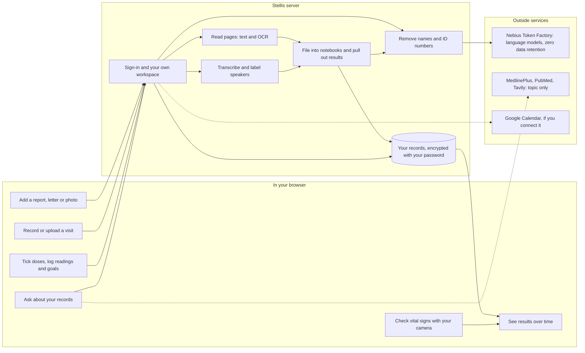

# How Stellis works

Stellis is a web app. Your browser shows the interface, and a Stellis server stores your records and does the reading, transcribing and filing. This page shows what each part does for you and where your data goes.

## What each part does for you

| You | What happens | Where |
| --- | --- | --- |
| Add a report, letter or photo | The server reads each page, with OCR for scans and photos. You can correct the text, and corrections stay | Server, Tesseract |
| Record or upload a visit | The server transcribes it, labels who spoke and writes a summary with links back to the moment in the recording | Server: whisper.cpp and sherpa-onnx for the transcript, a language model for the summary |
| Read a report explained | Stellis says what each result means for you, read together with your other results, and what to ask next, linked to the page it came from | Server, language model |
| File records | Stellis suggests which notebook a record belongs in (Bloodwork, IVF, Nutrition, Pregnancy and others) and which values to add. Nothing is added until you approve it | Server, language model |
| Ask a question | The answer cites the pages it used. General medical questions can also use public research | Server, language model, research services |
| Tick doses, log readings and goals | Saved to your records and shown on My Health and in each notebook | Server |
| Talk to Stellis | Speech is recognised on the server and replies are spoken back | Server: Moonshine and Silero for speech, Kokoro for the voice |
| Check vital signs | Pulse, breathing and heart rate variability from about 30 seconds of camera video | Your browser only |
| See results over time | Lab results and home readings on one chart, each point linked to its record | Browser, from your records |
| Plan visits | Booked visits, due tests and doses appear on one calendar | Server, and Google Calendar if you connect it |

## Where your data goes

| Data | Where it goes |
| --- | --- |
| Your records, recordings and notes | Stored on the Stellis server, encrypted (AES-256-GCM) with a key that only your password or recovery key unlocks. Stellis stores neither |
| Text sent for summaries, answers and filing | Sent to Nebius Token Factory after names, email addresses, phone numbers, record numbers and birth dates are replaced with placeholders. Token Factory keeps nothing (zero data retention) |
| Research questions | Only the general medical topic, never personal details |
| Calendar | Read from Google Calendar only after you connect it |
| Camera video for vital signs | Never leaves your device |

Each signed-in account runs in its own server process, and its records are unlocked only while that person is signed in. You can export everything, and deleting your account destroys its key.

## Versions

The same app runs three ways, set by `STELLIS_RUNTIME_PROFILE`:

| Version | Agents run | Models |
| --- | --- | --- |
| `direct` (the live site) | On the Stellis server | Nebius Token Factory |
| `cloud` | OpenClaw inside a NemoClaw sandbox on Nebius | Nebius Token Factory |
| `local` | OpenClaw inside a NemoClaw sandbox on your own machine | Ollama on that machine |

## Code

| Part | Where |
| --- | --- |
| Browser interface | `src/stellis/static/` |
| Server, sign-in and per-account workspaces | `src/stellis/server.py`, `account_gateway.py`, `workspaces.py`, `vault.py` |
| Reading pages | `document_ocr.py`, `document_ocr_worker.py` |
| Recordings | `recording.py`, `processing.py`, `rust/stellis-audio-worker/` |
| Filing, results and suggestions | `notebook_filing.py`, `report_measurements.py`, `suggestions.py` |
| Placeholders before model requests | `privacy.py` |
| Agent versions | `launch.py`, `agent_runtime.py`, `runtime_profile.py` |
